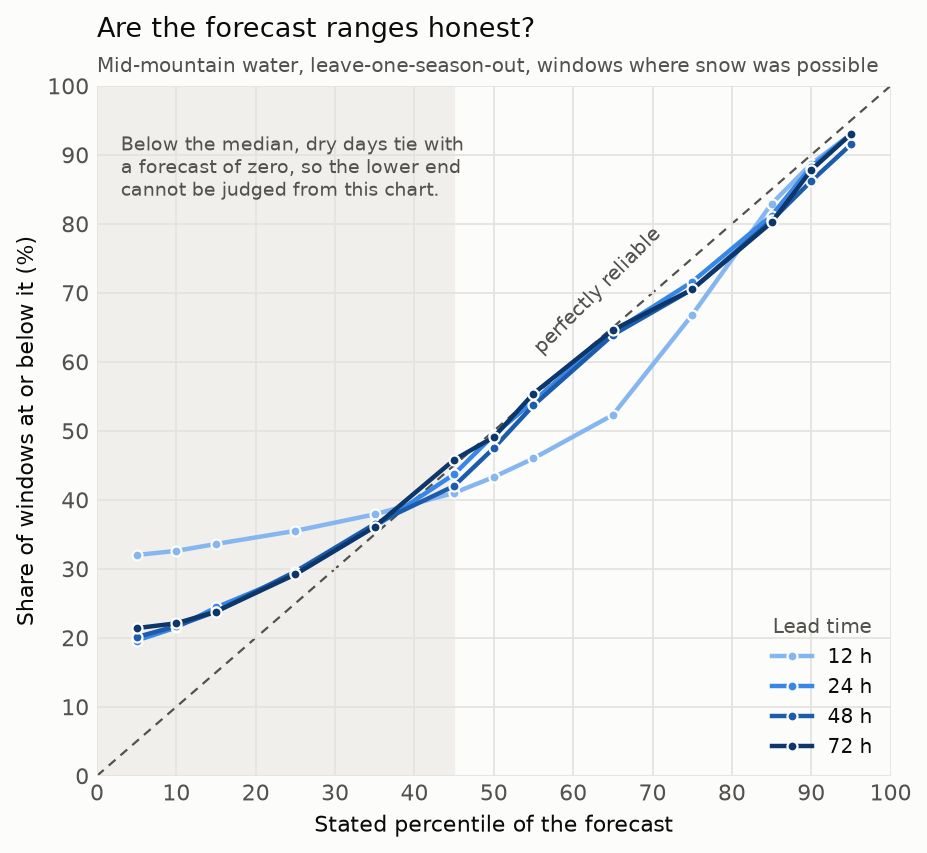

# Phase 3: model layers 1 to 4, with hindcast scores

Date: 2026-11-24. Checkpoint for review. Every score below is from seasons the model was not trained on (leave one season out). Numbers come from `data/model/scores_*.json`, which `uv run vailsnow hindcast` regenerates.

> **Scores on this page predate a correction.** On 2026-11-24 the gauge record was corrected for late ticks and every model refitted. The corrected scores are in `GAUGE_TICKS.md`; rankings did not change.

## Verdict

- **Mid-mountain water (layer 1): better than raw HRRR, level with the National Blend, not better.** The brief asked for this to be said plainly if it happened. It happened.
- **Snow-to-liquid ratio (layer 4): clearly better than Kuchera, climatology and the National Blend's ratio.**
- **Spreading snow across terrain (layer 2): the long-term PRISM pattern carries nearly all the skill.** The orographic theory added nothing at the test sites. HRRR's pattern for the day adds a little.
- **Snow level (layer 3): cannot be proven with this data.** Winter rain at the base is too rare in the record pulled.
- **End to end, in inches of snow on the valley floor: the National Blend beats this model by 13%.** This model is level with the NWS official forecast and is better calibrated when it calls for 3 in or more.
- **Two mistakes were found and fixed along the way,** one of which changed Phase 2's conclusions. See "Corrections".

## What everything is scored against

| Target | Where | What it tests |
|---|---|---|
| Precipitation gauge, Vail Mountain SNOTEL | 10,290 ft, mid-mountain | Layer 1. The only measurement on the hill |
| Six neighbouring SNOTEL gauges and five valley observers | 7,200 to 11,300 ft, within 30 km | Layer 2: given Vail's amount, what did the others get |
| Valley observers' new snow and its water content | 7,200 to 8,400 ft | Layers 3 and 4, and the end-to-end snowfall test |

Windows run from 5 am or 5 pm Mountain Standard Time (12z, 00z). "Lead" is hours from issue to the end of the window: 12 h is the next 12 hours, 24 h the next 24, 48 h is hours 24 to 48, 72 h is hours 48 to 72.

The gauge reads to 0.1 in and the pillow beside it disagrees with it by 0.13 in on a typical day, so errors much below 0.05 in per day are inside the instrument noise.

## Layer 1: liquid precipitation at mid-mountain

Mean absolute error in inches of water per window. Lower is better.

| Lead | Seasons | This model | Raw HRRR | Gain over raw (90% range) | Climatology |
|---|---|---|---|---|---|
| 12 h | 8 | 0.034 | 0.037 | 6% (4 to 9%) | 0.047 |
| 24 h | 8 | 0.063 | 0.068 | 8% (4 to 11%) | 0.096 |
| 36 h | 8 | 0.064 | 0.071 | 9% (3 to 14%) | 0.096 |
| 48 h | 6 | 0.064 | 0.073 | 12% (6 to 18%) | 0.093 |
| 72 h | 6 | 0.069 | 0.084 (raw GFS) | 18% (11 to 26%) | 0.093 |

Against the baselines the brief named, on the six seasons where all exist (2020-21 on):

| Lead | Windows | This model | National Blend | NWS official | Raw HRRR |
|---|---|---|---|---|---|
| 12 h | 2,138 | 0.032 | 0.032 | 0.035 | 0.034 |
| 24 h | 1,067 | 0.058 | **0.057** | 0.060 | 0.063 |
| 48 h | 1,047 | 0.064 | 0.064 | 0.066 | 0.073 |
| 72 h | 1,017 | **0.069** | 0.072 | 0.072 | 0.084 (GFS) |

- **Against the National Blend: a tie at 12, 24 and 48 h.** At 24 h the Blend is ahead by 2%, well inside the noise (the 90% range runs from 8% behind to 4% ahead). At 72 h this model is ahead by 5%, also inside the noise.
- **Against the NWS official forecast: ahead by 3 to 9%**, clearly so only at 12 h and 72 h.
- **As a probability forecast it has no competitor here yet.** Its CRPS at 24 h is 0.046 against 0.070 for climatology. The Blend's percentile files were not pulled, so there is no fair probabilistic comparison with it.

### How it works

A gradient-boosted model per lead time. Inputs are HRRR's precipitation at the gauge cell, around it and at the nearby cell whose model elevation matches the gauge, plus wind at about 600 mb, temperature, stability, humidity and column moisture. GFS precipitation joins at 24 and 48 h, and is the only model at 72 h. Thirteen quantile models give the range; a separate model gives the mean.

HRRR's terrain puts the gauge cell at 2,818 m, 318 m below the real site, and the next cell south gets nearly twice the precipitation in some storms. Feeding the model the neighbourhood, not one cell, is where most of the gain comes from.

### Where it is weak

- **The biggest days.** On the 48 days with 0.5 in of water or more, the model's median was 0.36 in low and raw HRRR 0.19 in low; the model's error (0.36) was worse than raw HRRR's (0.26). A median forecast of a skewed quantity does this by design, but it is the wrong direction for powder days. The upper end of the range is what to read on those days.
- **Judged by what it forecast, it is honest.** When it called for 0.25 to 0.5 in (113 days) the gauge averaged 0.38 in; the model ran 0.04 low and raw HRRR 0.07 high.
- **Northwest flow.** No gain over raw HRRR there (0.061 against 0.060). The gain is in southwest, west and weak flow.
- **Storm totals.** Over 28 storms of 1 in or more, summing the day-ahead forecasts: error 0.40 in against 0.41 for raw HRRR, and 0.23 in low on average.
- **The ranges are slightly too narrow at the top.** The gauge exceeded the stated 90th percentile on 12% of windows, not 10%, and the 75th on 28%, not 25%.

## Layer 2: spreading it across terrain

Given what the Vail gauge measured, predict what each of 11 other sites got. Mean absolute error in inches per day over 5,136 site-days with precipitation:

| Method | Error | Usable for ski zones? |
|---|---|---|
| Same as Vail | 0.144 | yes |
| Raw HRRR at the site | 0.128 | yes |
| HRRR's site-to-Vail ratio for the day | 0.142 | yes |
| Site's own long-term ratio | 0.125 | no (needs a gauge there) |
| Site's own ratio by flow regime | 0.124 | no |
| PRISM pattern | 0.120 | yes |
| PRISM x orographic theory (Smith-Barstad) | 0.120 | yes |
| **PRISM x damped HRRR departure** | **0.117** | yes |

- **PRISM alone captures most of what is predictable.** Day-to-day differences between sites are mostly noise at this scale.
- **The orographic theory did not help.** The fit kept choosing the longest delay and the weakest strength on offer, which amounts to switching it off. Run at full strength it moved the west-side sites in the right direction between regimes, but by too much, and daily error rose. It is implemented and tested (`model/orographic.py`) and is not used in the forecast.
- **HRRR's raw pattern has standing biases** (it runs high toward Copper), which is why its daily ratio hurts. Removing its own average pattern and keeping half of what is left gives a 2% gain over PRISM and tracks the regime shifts better: at McCoy Park the observed ratio to Vail goes from 0.65 in northwest flow to 1.04 in southwest; this method gives 0.69 and 0.83, PRISM gives 0.79 in both.
- **The forecast uses the last row.** For ski zones that means the PRISM ratio for each zone and elevation band, times the damped HRRR departure at the zone's 3 km cell.

What this means for zone numbers: differences between zones are almost entirely the long-term PRISM pattern, which is mostly elevation. The weather of the day moves them by a few percent. Nothing in this phase is evidence for or against Northwoods over Lionshead in a given storm.

## Layer 3: snow level

Near-surface wet-bulb temperature from HRRR is fitted against model elevation within about 30 km, which gives a wet-bulb for any height. Snow share runs from all snow at 0 C to all rain at 2 C; the snow level is where wet-bulb crosses 0.5 C.

Test: 981 valley observer days that were clearly snow or clearly rain.

| Rule | Brier score | Rain days caught | Snow days kept |
|---|---|---|---|
| Wet-bulb ramp (this model) | 0.027 | 15 of 25 | 98% |
| Plain temperature ramp | 0.068 | 21 of 25 | 92% |
| National Blend snow level (492 days) | 0.128 | 75% | 88% |
| Always snow | 0.025 | 0 of 25 | 100% |

With 25 rain days in eight winters, "always snow" scores as well as anything. The wet-bulb rule beats plain temperature and the Blend's snow level, but it cannot be shown to add value from November to April. October and May forecasts were not pulled; they would give far more rain cases.

## Layer 4: snow-to-liquid ratio

Trained on 710 morning reports from the town station and the CoCoRaHS observers with at least 2 in of snow and 0.11 in of water. Inputs: temperature and wet-bulb at the site's elevation, temperature at 700 and 500 mb, wind at 600 mb, humidity at 700 mb, the amount of water, and elevation.

| Method | Ratio error | Snow error, given the measured water |
|---|---|---|
| **This model** | **3.2** | **0.92 in** |
| Straight line on 700 mb temperature | 3.8 | 1.11 in |
| Local climatology (one number) | 3.9 | 1.10 in |
| Flat 15 to 1 | 3.9 | 1.14 in |
| Kuchera | 5.0 | 1.31 in |
| Flat 10 to 1 | 5.6 | 1.36 in |

On the 363 reports where the National Blend's ratio exists (2023 on): this model 3.0, the Blend 4.3, Kuchera 5.1.

- 16% better than local climatology and 29% better than the Blend's ratio.
- It runs 0.6 low on average, because it is fitted to the median of a skewed quantity.
- **Elevation.** The ratio varies with elevation through temperature only. All training sites are on the valley floor. Nothing measures the ratio at mid-mountain; the SNOTEL depth sensor sees settled snow (median 8 to 1 over a day) and was not used.
- The Utah models were not used or run, as agreed. The two papers' full text is still unread.

## End to end: inches of snow where it is measured

All four layers chained, at the five valley observers, six seasons, 3,923 site-days averaging 0.7 in:

| Forecast | Error | Bias |
|---|---|---|
| **National Blend** | **0.52 in** | +0.17 in |
| NWS official | 0.59 in | +0.27 in |
| This model | 0.60 in | +0.10 in |
| Raw HRRR x Kuchera | 0.79 in | +0.48 in |

- **The Blend wins by 13%.** This model is level with the NWS official forecast.
- **When this model calls for 3 in or more (192 times) the observed mean was 3.97 in against a forecast mean of 3.97.** When the Blend or NWS call for 3 in or more they average 5.2 in forecast against 3.3 to 3.6 observed.
- On days that brought 3 in or more, all three miss by about 2 in; this model misses low (-1.9 in), the others slightly low.
- The valley is not what this model is built for: its water forecast is tuned to the mid-mountain gauge and reaches the valley through a fixed PRISM ratio. It is still the only snowfall test available, and the result stands.

## February 2020, as the model would have forecast it

Day-ahead forecasts issued each morning, with that season held out of training:

| 24 h from 5 am | Gauge | Model median | Model range (10th to 90th) | Raw HRRR |
|---|---|---|---|---|
| Feb 5 | 0.10 in | 0.08 | 0.00 to 0.22 | 0.10 |
| Feb 6 | 1.10 in | 0.52 | 0.17 to 1.12 | 1.18 |
| Feb 7 | 1.10 in | 0.30 | 0.12 to 0.56 | 0.38 |
| Feb 8 | 0.31 in | 0.19 | 0.06 to 0.32 | 0.27 |

Summed over the storm, the model's expected water at mid-mountain was 2.2 in (range 0.5 to 3.1) against 2.6 in measured, and about 30 in of snow (range 6 to 43) against the 38 in in your brief.
The first big day landed at the top of the range. The second was missed by the model and by HRRR alike: both expected the storm to wind down a day early.
By zone, the storm-total snow ran from 18 in on lower Lionshead and Golden Peak to 30 to 32 in in the Back Bowls and at Mid-Vail, with Northwoods at 26 in. That spread is PRISM and elevation.
In the valley the observers measured 15 to 17 in on Feb 6; the model gave 7 to 8 in.

The January 2014 case study is not done. It predates every forecast archive pulled here and needs the GEFS reforecast.

## Corrections

**1. Every SNOTEL gain was dated one day early, from Phase 0 until today.** The SNOTEL service returns end-of-day readings unless asked for start-of-day, and my loader assumed start-of-day. Found when forecasts matched the gauge only after a one-day shift (correlation 0.33 unshifted, 0.73 corrected). Fixed in the loader, guarded by a test that compares the daily and hourly records, and Phase 2 was rebuilt. `STORM_CLIMATOLOGY.md` has a table of what changed. The main reversal: the claim that southwest flow brings the most water per day is withdrawn; west and west-northwest flow carry the most, and northwest-flow top storms rise from 22 to 31.

**2. National Blend and NWS grids were read with every second row mirrored.** Both store odd rows right to left. The mid-mountain cell sits on an even row, so layer 1's comparison was never affected, but the valley cells were, and a first run showed this model beating the Blend on snowfall by 14%. That was false. The reader is fixed and checked against the library's own point lookup, both archives were downloaded again, and the table above is the corrected result.

## Departures from the brief

- **HRRR era is 2018 on, not 2014 on.** The cheap chunked copy of HRRR holds forecasts from July 2018. Earlier runs exist only as whole-country files and were not pulled, so there are 8 seasons, not 12, and the 12 h lead has 8 seasons, not the 12 the Phase 0 matrix promised.
- **48 and 72 h have 6 seasons**, limited by the GFS archive (2021 on). GEFS members were not pulled; that is about 160 GB and belongs with Phase 4's uncertainty work.
- **scikit-learn's gradient boosting, not LightGBM.** Same method, one fewer system dependency.
- **A plain range reader for GRIB files, not herbie.** It keeps only a window around the mountain, so roughly 100 GB of transfer became 2.5 GB on disk.
- **Regimes after January 2023 come from HRRR**, since the reanalysis copy stops there.
- **The "blend" of models is the boosted model's job**, not a fixed weighted average.

## Not done

- Forecasts before July 2018, and the 60 HRRR runs missing from the chunked copy (mostly November 2019 and November 2020).
- October and May, which the snow-level test needs.
- The National Blend's percentile forecasts, for a fair probabilistic comparison.
- The January 2014 case study.
- Scores by regime and storm size are computed for every lead (`scores_precip.json`) but only the 24 h ones are discussed here.
- The zone draft from Phase 1 is still unreviewed. Zone numbers above use it as drawn.

## Built

| Piece | Where |
|---|---|
| HRRR forecasts as issued, 2,880 runs | `fcst/hrrr.py`, cache 2.3 GB |
| National Blend, NWS grids, GFS as issued, 5,460 runs | `fcst/archive.py`, `fcst/grib.py` |
| Hourly gauge record tied to the daily one, 7 sites | `obs/hourly.py` |
| Forecast-against-observed table, 8,027 windows | `model/table.py`, `data/model/table.parquet` |
| Layer 1 and its hindcast | `model/precip.py`, `model/hindcast.py` |
| Layer 2, with the orographic theory | `model/downscale.py`, `model/orographic.py` |
| Layer 3 | `model/snowlevel.py` |
| Layer 4 | `model/slr.py` |
| End-to-end snowfall and zone output | `model/snowfall.py`, `model/zones.py` |
| Scores and the reliability figure | `verify/scores.py`, `verify/plots.py` |
| Tests | 119 pass |

## For Phase 4

1. **The top of the range is the priority.** Big days are under-called and the 90th percentile is a little low. Ensemble spread and the upside flags the brief lists are the natural fix.
2. **Blend in the National Blend.** It is public output, it ties this model at the gauge and beats it in the valley. Using it as an input is the cheapest gain available. It was kept out of this phase so the comparison would be clean.
3. **Wind redistribution is where zone differences will come from.** Layer 2 shows the precipitation pattern itself is nearly fixed.
4. **Pull October and May** before trusting the snow level at the base.
