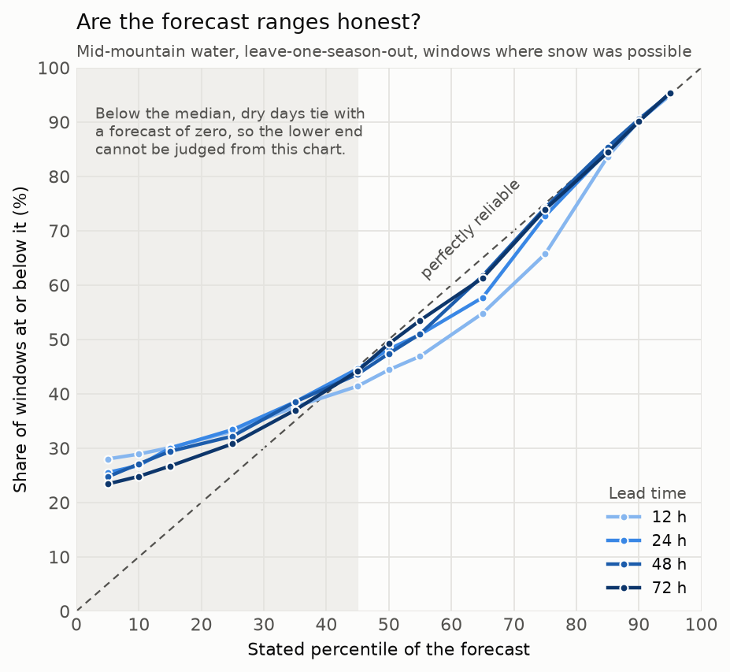

# Phase 4: wind, settlement and uncertainty, rescored

Date: 2026-11-24. Checkpoint for review. Scores are from seasons held out of training, and come from `data/model/scores_*.json`, which `uv run vailsnow hindcast` regenerates.

> **Correction, Phase 6 (2026-11-24).** The table under "Layer 5" gives ridge-level wind as 0.7 of the 600 mb wind. That was an assumption. Measured at a 12,075 ft summit station over 41,562 forecast hours, sustained wind is 0.47 of the 600 mb wind, so the forecast now uses 0.5. The wind speeds in the table are ridge-level and still stand; what changed is that a given forecast now produces a weaker ridge wind, so the after-wind layer moves less snow than Phase 4 and 5 showed.

> **Scores on this page predate a correction.** On 2026-11-24 the gauge record was corrected for late ticks and every model refitted. The corrected scores are in `GAUGE_TICKS.md`; rankings did not change.

## Verdict

- **The forecast ranges are now honest at the top.** The 90th percentile is exceeded 9% of the time (it was 12%).
- **Settlement works and is checked on the mountain.** Predicting the next-morning depth change at seven SNOTEL sites from the water that fell: 1.57 in error, against 1.78 for a fixed ratio and 2.54 with no settling.
- **Snow level now has a real test, and passes it.** With October and May pulled there are 107 rain days; the wet-bulb rule catches 85% of them and halves the error of "always snow".
- **Big days are still under-called.** New inputs did not fix it.
- **Adding the National Blend as an input gained nothing.** I said in Phase 3 it would be the cheapest gain available. It was not.
- **Wind and sun are built and cannot be verified.** Nothing measures how snow is spread within the ski area.
- **Against the National Blend overall: still a tie, here and on the mountain.**

## Layer 1 again: new inputs and calibrated ranges

Three versions were run side by side: Phase 3's inputs; plus the previous HRRR run, the GEFS ensemble mean and two measures of disagreement between forecasts ("own"); and plus the National Blend's forecast as an input.

Mean absolute error at the gauge, inches of water:

| Lead | Phase 3 inputs | Own | With the Blend as input | The Blend itself (six seasons) |
|---|---|---|---|---|
| 12 h | 0.034 | 0.034 | 0.034 | 0.032 (model 0.032) |
| 24 h | 0.063 | 0.063 | 0.063 | **0.057** (model 0.059) |
| 36 h | 0.064 | 0.064 | 0.064 | not pulled |
| 48 h | 0.064 | 0.063 | 0.063 | 0.064 (model 0.063) |
| 72 h | 0.070 | 0.068 | 0.068 | 0.072 (model **0.068**) |

- **Nothing changed at 12 to 36 h.** At 48 and 72 h the ensemble inputs gave 2 to 3%.
- **The Blend as an input added nothing on top of that**, so the forecast uses the "own" version and stays independent of it.
- **Against the Blend:** behind by 3% at 24 h, ahead by 1% at 48 h and 5% at 72 h. None of these is outside the noise.

### Ranges

Each upper percentile is now stretched away from the median until it is exceeded as often as it claims. The stretch is fitted on other seasons and comes to 1.1 to 1.3 times.

| Stated percentile (24 h, snow possible) | Phase 3 | Phase 4 |
|---|---|---|
| 75th | 72% | 75% |
| 85th | 81% | 86% |
| 90th | 88% | 91% |
| 95th | 93% | 95% |

### Big days

On the 48 days with 0.5 in of water or more (24 h lead):

| Forecast | Error on those days |
|---|---|
| Model median | 0.36 in |
| Model mean | 0.33 in |
| Model 75th percentile | 0.26 in |
| Raw HRRR | 0.26 in |

Only 42% of those days came in under the model's 90th percentile. Any honest forecast looks low when judged only on the days that turned out big, but this is the part of the model I would trust least on a powder morning. Read the 75th percentile, not the median, when the setup looks good.

### The upside-surprise setup from the brief

Tested as: northwest flow, 500 mb wind of 30 m/s or more, and humidity of 80% or more near ridge level. Vertical motion in the snow-growth layer is not in the fields pulled.

| Lead | Windows in 8 seasons | Gauge average | Model median | Exceeded the 90th percentile |
|---|---|---|---|---|
| 12 h | 16 | 0.28 in | 0.17 in | 6 of 16 (normally 1 in 10) |
| 24 h | 9 | 0.61 in | 0.41 in | 1 of 9 |

The setup is rare, the gauge beat the median in it by about half, and 4 of the 9 days brought 0.5 in or more. That supports the brief, on too few cases to build a rule from. The map can flag it; it should not change the numbers yet.

## Layer 3 again: snow level, with October and May

| Rule | Brier score | Rain days caught | Snow days kept |
|---|---|---|---|
| **Wet-bulb ramp** | **0.041** | 91 of 107 | 96% |
| Plain temperature ramp | 0.088 | 95% | 89% |
| Always snow | 0.091 | none | 100% |

Phase 3 could not separate these with 25 rain days. With 107 it can: wet-bulb is the right variable. The National Blend's snow level was not pulled for October and May, so it is not in this table.

## Layer 6: settlement

Two layers stepped hour by hour: new snow, which densifies fast at first and faster when warm, and the old pack, which settles slowly. The rate laws follow Anderson (1976); the constants are fitted to SNOTEL depth sensors.

Test: given the water that fell, predict the 24-hour change in depth at seven SNOTEL sites.

| Method | Snow days (2,148) | Days with 1 in of water or more (18) |
|---|---|---|
| **Ratio from layer 4, then settling** | **1.57 in** | **4.2 in** |
| One fixed depth-per-water ratio | 1.78 in | 4.7 in |
| Ratio from layer 4, no settling | 2.54 in | 7.7 in |

- **About two thirds of the as-fallen depth is left the next morning** (67%).
- **After a second, dry day about 56% is left.** On 205 such pairs the model settles 0.4 in too much by the second morning.
- The pack's own settling comes to about 0.7 in a day on dry days, which the model matches (0.8).
- The depth sensors read to an inch, so about 1.5 in of error is close to the floor.
- This is also the first check of the snow-to-liquid ratio at mountain elevations: as-fallen ratio times settling reproduces the depth sensors without bias (+0.01 in).

### End to end on the mountain

Forecast water, ratio and settling, against the depth change the Vail mid-mountain sensor recorded. Six seasons, 836 days:

| Forecast | Error | Bias |
|---|---|---|
| National Blend snowfall, with this model's settling applied | 0.90 in | -0.19 |
| NWS official snowfall, with this model's settling applied | 0.90 in | -0.07 |
| **This model** | 0.95 in | +0.12 |
| National Blend snowfall as issued (as-fallen) | 1.17 in | +0.92 |

Level with both again, a shade behind. The settling step is worth more than the choice of forecast: it takes the Blend from 1.17 to 0.90. On the 71 days the depth rose 3 in or more, every settled forecast was 1.5 to 1.8 in low.

In the valley the Phase 3 result stands: the Blend 0.52 in, NWS 0.59, this model 0.59.

## Layer 5: wind redistribution (not verifiable)

Each 10 m cell has a shelter angle for the wind direction, from Phase 1. Exposed, treeless cells lose snow; it is carried about 150 m downwind and laid down in sheltered cells; the total is conserved. Light, cold snow moves more easily than dense or sticky snow.

The constants are assumptions, chosen to be conservative:

| Constant | Value |
|---|---|
| Wind where transport starts, and where it tops out | 5 and 20 m/s at ridge level |
| Most a fully exposed, open cell can lose | 40% |
| Most a drift can add | 80% of what fell there |
| Ridge-level wind as a share of the 600 mb wind | 0.7 |

What it does to an even 10 in snowfall:

| Wind | Cells changed by more than 10% | Range across cells | Zone averages |
|---|---|---|---|
| Northwest, 20 m/s | 28% | 6 to 18 in | within 3% |
| Northwest, 10 m/s | 5% | 8.6 to 18 in | within 1% |
| Under 5 m/s | none | 10 in | unchanged |

- **Wind moves snow between features, not between zones.** The map will change at the scale of a gully or a ridge crest; the zone totals barely move. This does not support a zone-level wind advantage for Northwoods or anywhere else.
- **Trees do what the brief says:** canopy stops scouring completely at full cover.
- There is no drift measurement to tune or test any of it. It ships as a toggle and should be labelled as modelled.

## Sun

Clear-sky direct sunlight on each cell's slope and aspect over the day, relative to flat ground. Early February zone averages: Back Bowls 1.2 to 1.4, Game Creek and Golden Peak 0.9, the rest of the Front Side 0.5 to 0.7, Blue Sky Basin 0.7 to 0.9.

It speeds new-snow settling on a clear day after a storm. For the February 6, 2020 snowfall, the top of China Bowl goes from 13 in the next morning to 10 in after a clear day, and lower Lionshead from 6.5 to 5.0. The strength of that effect is an assumption: every SNOTEL site is flat and sheltered, so aspect cannot be tested. Shadows cast by neighbouring terrain are not traced.

## February 2020, with every layer

Storm total over the five mornings, with that season held out:

| | Water | Snow as fallen | After wind | Sum of next-morning settled depths |
|---|---|---|---|---|
| Mid-Vail / Mountaintop | 2.2 in (0.4 to 3.4) | 32 in (6 to 50) | 31 in | 22 in |
| China Bowl | 2.4 in | 34 in | 33 in | 25 in |
| Northwoods | 1.9 in | 27 in | 27 in | 19 in |
| Lionshead / Born Free | 1.2 in | 18 in | 18 in | 12 in |

The gauge measured 2.6 in of water. On the peak day the ridge wind was put at 15 m/s from 325 degrees; within the top of China Bowl that spread 17 in into a range of 15.5 to 19 in between cells.
The second big day (Feb 7) is still missed: 1.10 in fell and the 90th percentile was 0.72 in.

## Departures from the brief

- **Ensembles are the GEFS mean and spread only**, from September 2020. Individual members, the ECMWF ensemble and REFS were not pulled.
- **Ranges per zone come from the water forecast's range**, scaled by each zone's factors. Uncertainty in the snow-to-liquid ratio and in the zone factors is not added on top. The check available says the result is about right: 85% of valley snowfall observations fall inside the 10th to 90th range when snow is possible, and 75% of mid-mountain depth changes.
- **Settling assumes the day's snow falls evenly through the 24 hours.** HRRR's hourly timing is on disk and not yet used.
- **Sun assumes clear sky the day after.** Cloud cover was not pulled.
- **Layers 2, 3 and 4 are now scored with October and May included**, so their numbers differ slightly from Phase 3's. None changed its ranking.

## Not done

- Any verification of wind or aspect effects.
- A fix for big days.
- The January 2014 case study, forecasts before July 2018, the Blend's percentile files (all carried over).
- Your review of the Phase 1 zone draft.

## Built

| Piece | Where |
|---|---|
| Settlement, its fit and three tests against SNOTEL | `model/settle.py` |
| Wind redistribution and sun exposure on the 10 m grid | `model/exposure.py` |
| Model versions, range calibration, tail scores, upside flag | `model/precip.py`, `model/hindcast.py` |
| Zone output with after-wind and settled depths | `model/zones.py` |
| GEFS mean and spread, October and May HRRR | `fcst/archive.py`, `fcst/hrrr.py` |
| Tests | 135 pass |

## For Phase 5

1. **The map has four honest layers to toggle:** as fallen, after wind (modelled, unverified), settled next morning (verified at SNOTEL), and density.
2. **Show the range, and lead with it when the upside setup is flagged.**
3. **Label what is measured and what is not.** Mid-mountain water and settled depth are checked against instruments. Zone differences are PRISM. Wind and sun are physics with assumed constants.
4. **The live forecast needs RRFS or HRRR pulled in real time.** Everything so far runs on archives.
